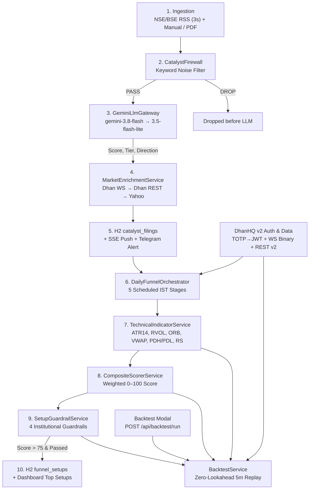
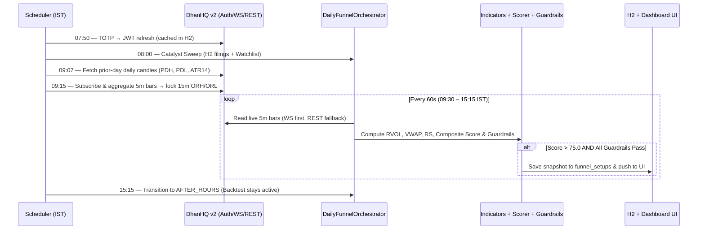

# NSE Institutional Catalyst Terminal

An event-driven **Institutional Catalyst Screener, 3-Stage Intraday Trading Funnel & Historical Backtest Terminal** for Indian equities (NSE), built with **Java 17**, **Spring Boot 3.2.5**, **DhanHQ v2**, **Gemini LLM**, and **embedded H2**.

---

## Architecture Overview



### System Data-Flow (ASCII)

```text
  [NSE/BSE RSS (3s)] ──┐
  [Manual / PDF API] ──┴─► [CatalystFirewall] ─► (PASS) ─► [Gemini 3.8 Flash / 3.5 Lite]
                                  │                                   │
                               (DROP)                                 ▼
                             [Ignored]                    [MarketEnrichmentService]
                                                          (Dhan WS → REST → Yahoo)
                                                                      │
         ┌────────────────────────────────────────────────────────────┤
         ▼                                                            ▼
  [H2 catalyst_filings]                                    [SSE + Telegram Alerts]
         │
         ▼
  [DailyFunnelOrchestrator] ◄── [DhanHQ v2: TOTP JWT + WS 5m Bars + REST v2]
    │  07:50 Token Refresh  │  08:00 Catalyst Sweep  │  09:07 Pre-Market
    │  09:15 ORB Capture    │  09:30–15:15 Live Rank (60s)
    ▼
  [TechnicalIndicatorService] ─► [CompositeScorerService] ─► [SetupGuardrailService]
   (ATR14, RVOL, VWAP, ORB, RS)    (0.25C+0.25R+0.25S+...)     (Liq, ATR, Chop, 1:2 R:R)
                                                                      │
                                                      (Score > 75 & Passed)
                                                                      ▼
                                                       [H2 funnel_setups + Dashboard]
```

### Daily Intraday Funnel Sequence (IST)



---

## End-to-End Application Flow

### 1. Catalyst Ingestion & AI Scoring (Continuous)
1. **Feed Polling & Manual Submission**
   - `NseFeedPoller` polls NSE and BSE corporate announcement RSS feeds every **3 seconds**, deduplicating filings by `filing_uid` against H2 `catalyst_filings`.
   - Manual text and PDF filings can be analyzed on demand via `POST /api/analyze` and `POST /api/analyze/pdf` (`PdfExtractorService` extracts up to 6 pages / 10,000 characters via Apache PDFBox).
2. **Pre-LLM Firewall (`CatalystFirewall`)**
   - `0ms` pattern filter that drops routine compliance noise (board meeting intimations, trading window closures, etc.) while passing high-impact events (Order Wins, Joint Ventures, Earnings Beats, USFDA/SEBI updates, Management/Auditor changes, Block Deals).
3. **LLM Evaluation (`GeminiLlmGateway` → `CatalystEvaluatorService`)**
   - Evaluates filings with `gemini-3.8-flash` (automatic fallback to `gemini-3.5-flash-lite`) using a strict JSON `responseSchema`, outputting:
     - `catalyst_score` (`0–100`), `signal_tier` (`HIGH_CONVICTION` / `WATCHLIST` / `NOISE`), `direction` (`BULLISH` / `BEARISH` / `NEUTRAL`), `category`, `order_value_cr`, `order_to_mcap_pct`, `is_actionable_intraday`, `headline_summary`, `institutional_rationale`, and `key_risk`.
   - On upstream Gemini `503` errors, bogus `NOISE` records are **not** saved: live filings are queued for a 30s retry (up to 3 retries), and manual `/api/analyze` returns HTTP `503`.
4. **Live Market Enrichment & Alerts**
   - `MarketEnrichmentService` enriches filings with **LTP**, **day change %**, and **Market Cap (`₹ Cr`)** using the fallback chain: **Dhan WebSocket → Dhan REST → Yahoo Finance**.
   - Persists to H2 (`./data/catalystdb` with 365-day retention), pushes real-time updates to the UI via SSE (`/api/stream/catalysts`), and triggers `TelegramAlertService` (`score >= 70` general, `>= 40` for Watchlist symbols).

---

### 2. DhanHQ v2 Auth & Market Data Layer
- **TOTP Authentication (`DhanAuthService` & `TotpUtil`):** Mints a JWT using `DHAN_CLIENT_ID`, `DHAN_PIN`, and `DHAN_TOTP_SECRET` (with HTTP `Date` header server-clock skew sync), persists the token in H2 `dhan_token_cache`, and refreshes daily at **07:50 IST** (or on demand via `POST /api/funnel/dhan/refresh`).
- **Instrument Master (`DhanInstrumentService`):** Loads **501** Nifty 500 constituents, **2,808** `NSE_EQ` securities, and **119** `IDX_I` indices (tracking 8 core indices for relative strength).
- **WebSocket Feed (`DhanWebSocketFeedService`):** Connects to `wss://api-feed.dhan.co?version=2` (RequestCode `17` Little-Endian binary decoder) and aggregates live ticks into **5-minute OHLCV bars** with delta volume (100-bar rolling window).
- **REST v2 Gateway (`DhanMarketGateway`):** Fetches live quotes, daily historical candles (6h cache), intraday 5m candles (45s cache), and company market cap with a 240ms inter-request throttle and `429`/`401` retry handling.

---

### 3. 3-Stage Intraday Trading Funnel (`DailyFunnelOrchestrator`)
All scheduled stages are guarded by `NseCalendarUtil.isTradingDay()` (skips weekends and NSE holidays):

| Time (IST) | Stage | Action |
|---|---|---|
| **07:50** | Token Refresh | `DhanAuthService` refreshes DhanHQ JWT via TOTP |
| **08:00** | Catalyst Sweep | Collects recent high-conviction catalyst stocks + watchlist candidates |
| **09:07** | Pre-Market Prep | Refreshes prior-day daily candles (`PDH`, `PDL`, `prevClose`, `ATR14`, 20d avg turnover) |
| **09:15–09:29** | Opening Range (ORB) | Locks 15-minute Opening Range High/Low (`ORH` / `ORL`) from 5m bars |
| **09:30–15:15** | Live Ranker (every 60s) | Computes indicators, composite scores, guardrails, and execution plans; persists snapshots to H2 `funnel_setups` |
| **15:15+** | After Hours | Transitions to `AFTER_HOURS`; manual scans and historical backtests remain active |

#### Technical Indicators (`TechnicalIndicatorService`)
Computes `ATR14`, 20-day average turnover (`₹ Cr`), time-normalized `RVOL`, 15m `ORH`/`ORL`, intraday `VWAP`, `PDH`/`PDL`, and 5-minute Relative Strength (`RS`) vs Nifty / sector indices.

#### Composite Scoring (`CompositeScorerService`)
$$\text{Score} = 0.25 \times \text{Catalyst} + 0.25 \times \text{RVOL} + 0.25 \times \text{Structure} + 0.15 \times \text{RS} + 0.10 \times \text{Liquidity} - \text{ATR\_Penalty}$$

- Setups must pass all guardrails and score **`> 75.0`** (strict) to qualify as ranked actionable setups (top 10).

#### Institutional Guardrails & Execution Math (`SetupGuardrailService`)
1. **Liquidity Floor:** Nifty 500 constituent, 20-day avg turnover `>= ₹20 Cr`, LTP `>= ₹50`.
2. **ATR Exhaustion Filter:** `> 2.0x–2.5x` 14d ATR move applies a `-10` score penalty; `> 2.5x` applies `-45` and a hard block.
3. **Midday Chop Mute:** Suppresses non-VWAP-pullback breakouts between **11:30–13:30 IST**.
4. **Minimum 1:2 Risk-to-Reward:** Sizes position quantity to `riskPerTradePct` (default `1.0%`) of `capitalInr` (default `₹1,00,000`) and verifies `>= 2.0R` against `PDH`/`PDL` overhead resistance/support.

---

### 4. Historical Backtest Engine (`BacktestService`)
- Accessible from the **Backtest** modal (`POST /api/backtest/run`) and **isolated** from the live funnel (does not mutate live state or H2).
- **Zero Lookahead:** Prior daily candles strictly satisfy `< sessionDate`; indicator evaluation at bar `i` only reads `subList(0, i + 1)`.
- **Replay Window:** Locks ORB on `09:15–09:29`, scans for first qualifying ORB break + composite score pass on `09:30–14:29`, and simulates forward through `15:15 IST` (checking **Stop Loss before Target** within the same 5m bar).
- **Catalyst Matching:** Uses H2 `catalyst_filings` for that date when available, or falls back to `assumedCatalystScore` (set `80` to simulate news-backed technicals).
- **Caps:** Up to **45 calendar days** and **12 symbols** per run.
- **Metrics Returned:** Passed Trades, Win Rate, Net P&L, Profit Factor, Avg R-Multiple, Max Drawdown, and `% of Losers Blocked by Guardrails`.

---

## API Endpoints

| Group | Method & Path | Purpose |
|---|---|---|
| **Catalyst Feed** | `POST /api/analyze`, `POST /api/analyze/pdf` | On-demand text or PDF catalyst scoring |
| **Streaming** | `GET /api/stream/catalysts` | Real-time SSE catalyst stream |
| **Funnel** | `GET /api/funnel/snapshot`, `POST /api/funnel/scan` | Live funnel snapshot & manual scan trigger |
| **Funnel** | `GET /api/funnel/history`, `POST /api/funnel/dhan/refresh` | H2 setup history & manual Dhan TOTP refresh |
| **Backtest** | `POST /api/backtest/run` | Run zero-lookahead historical strategy backtest |
| **Watchlist** | `GET/POST/DELETE /api/watchlist/**` | Manage pinned watchlist symbols |
| **System** | `GET /api/system/status`, `/api/system/events`, `/api/system/logs` | Health, pipeline events, and live log tail |

---

## Quick Start (Local)

1. Copy `.env.example` to `.env` and fill in `GEMINI_API_KEY` plus your DhanHQ v2 credentials (`DHAN_ENABLED=true`, `DHAN_CLIENT_ID`, `DHAN_PIN`, `DHAN_TOTP_SECRET`) and optional Telegram credentials.
2. Run locally:
   ```bash
   mvn spring-boot:run
   ```
3. Open [http://localhost:8085/](http://localhost:8085/).

### Running Unit Tests
```bash
mvn test "-Dtest=CatalystFirewallTest,TotpUtilTest,DhanWebSocketFeedServiceTest,BacktestServiceTest,CompositeScorerServiceTest,SetupGuardrailServiceTest,TechnicalIndicatorServiceTest"
```

### Oracle Cloud Deployment
- Systemd unit: [deploy/nse-catalyst-terminal.service](deploy/nse-catalyst-terminal.service) (`PORT=8081`, `-Xms128m -Xmx384m`)
- 1-click PowerShell deploy from repo root:
  ```powershell
  .\deploy\deploy-to-oracle.ps1 -Build
  ```
